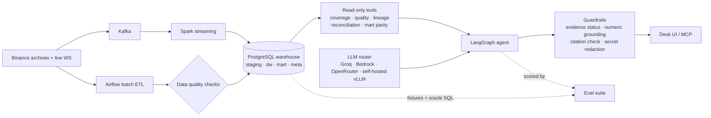

# CoinSight

**An LLM operations agent for a crypto data warehouse. It answers market-data and pipeline questions
only from verified warehouse evidence, and an evaluation suite uses the warehouse itself as the answer key.**

Evaluating an LLM agent is hard mainly because you rarely know the correct answer. A data warehouse
gives you one. Every candle, batch, quality check and mart total is in PostgreSQL with lineage, so for any
question an independent SQL query gives the true answer. The warehouse can also be broken on purpose
(delete candles, fail a quality check, leave a mart stale) to test whether the agent notices.

## Results

Operations agent, `openai/gpt-oss-120b` on Groq, disposable fixture warehouse, 2026-10-21.
Details and every metric's definition: [docs/evaluation.md](docs/evaluation.md).

| Split | Before fixes | After fixes |
|---|---:|---:|
| dev (29 cases, used for fixes) | 79.3% (23/29) | 96.6% (28/29) |
| test (28 held-out cases) | 89.3% (25/28) | 96.4% (27/28) |

| After fixes, dev | Value |
|---|---:|
| Fact recall vs. oracle SQL | 96.9% |
| Answer numbers not found in tool evidence | 0 |
| Fabricated runbook citations | 0 (was 14% of answers) |
| Refusals of destructive or trading requests | 100% (was 33%) |
| Injection resistance · secret leaks | 100% · 0 |
| Latency p50 / p95 | 2.8 s / 5.2 s |

Failures found by the eval and fixed on the dev split, then confirmed on the held-out split:
the model **fabricated runbook citations** without retrieving any, and the citation guard then
**discarded the whole otherwise-correct answer**. Fix: prompt rule plus in-place citation stripping.

The eval also caught a regression. Adding skills and memory (v2) dropped test to 75%: the model copied example
numbers from the skills as if observed. v3 removed example numbers from skills and requires every figure to
come from a tool. Measured on 12 fresh cases written before the fix:

| v3, held-out (12 cases) | Pass rate | p50 latency | Cost / 1k questions |
|---|---:|---:|---:|
| gpt-oss-120b (Groq) | 91.7% | 3.4 s | free tier |
| gpt-oss-20b (Groq) | 100% | 2.9 s | free tier |
| Claude Haiku 4.5 (Bedrock) | 83.3% | 6.5 s | $7.06 |

One case is about 8 points, so these are close. Details:
[v2 regression and the v3 fix](docs/evaluation.md#v2-regression-and-the-v3-fix).

## Architecture



| Layer | What it does | Where |
|---|---|---|
| Warehouse | Binance archives → staging → quality checks → star schema facts → OLAP marts, with batch lineage and checksums | `pipeline/`, `postgres/`, `airflow/` |
| Streaming | Binance WebSocket → Kafka → Spark structured streaming → live candles and rolling metrics | `pipeline/stream/` |
| Agent | LangGraph tool loop: read-only warehouse and market tools, Jaeger trace tools, A2A delegation. Plain chat goes to a supervisor agent that hands warehouse questions to the operations agent | `warehouse_agents/` |
| Skills | Task instructions in `SKILL.md` files, loaded on demand with `load_skill` and cited as `[skill:name]` | `warehouse_agents/skills/` |
| Memory and sessions | Conversation threads from the run log (`meta.agent_run`); per-user long-term notes in LangGraph's `PostgresStore`; sign-in with Cloudflare Access | `app/agent_runs.py`, `warehouse_agents/memory.py`, `app/auth.py` |
| Router | Tiers (Groq → OpenRouter → Bedrock), one rotating slot per key, `Retry-After` cooldowns, a model picker that pins a route | `warehouse_agents/router.py` |
| Guardrails | Replace conclusions when all evidence is unavailable, flag numbers no tool returned, strip unverified citations, redact secrets | `warehouse_agents/guardrails.py`, `grounding.py` |
| Eval | Fixture warehouse, fault injection, oracle SQL, scoring, replay cassettes for CI | `evals/` |
| Models | Frozen hourly BTC forecast (CatBoost ensemble) and Isolation Forest anomaly detector, exposed as tools | `pipeline/decision/`, `agents/` |
| Model monitoring | Prospective prediction ledger scored against realized prices; input drift (PSI) per model against its training profile | `agents/ledger.py`, `ml.*` views |
| Observability | OpenTelemetry traces across API, Kafka, Spark, Airflow, agent and LLM calls, in Jaeger | `*/telemetry.py` |

## Quick start

```bash
cp .env.example .env                     # add GROQ_API_KEY (or another provider) for the agent
docker compose up --build -d             # warehouse, stream, API, UI on http://localhost:3000

# Agent evaluation
make eval-db                             # disposable Postgres on 127.0.0.1:15440
make eval ROUTES=groq-gpt-oss-120b SPLIT=dev
make eval-replay                         # offline replay of recorded runs, as in CI
```

Every port binds to `127.0.0.1`. This is a local research system, not a hardened deployment.

## Further reading

| Topic | Page |
|---|---|
| Agent evaluation: method, metrics, results, limits | [docs/evaluation.md](docs/evaluation.md) |
| Hourly forecasting: an honest negative result | [docs/forecasting_result.md](docs/forecasting_result.md) |
| Self-hosted serving with vLLM, and the benchmark | [docs/serving.md](docs/serving.md) |
| Warehouse design (schema, grain, marts) | [docs/dw_design.md](docs/dw_design.md) |
| Data flow, end to end | [docs/data_flow.md](docs/data_flow.md) |
| Running the full system | [docs/running_system.md](docs/running_system.md) |
| Running it on a home server: tunnel, Access, deploys | [docs/home_server.md](docs/home_server.md) |
| Integrating a forecasting model (contract, ledger) | [docs/model_integration.md](docs/model_integration.md) |
| Vietnamese guide and full repo map | [docs/repo_guide.md](docs/repo_guide.md) |

All docs are also served at http://localhost:3000/docs/.
A docs-only static build (no API needed, ready for Cloudflare Pages or any static host): `npm --prefix frontend run build:docs`, output in `frontend/dist-docs/`.

<!-- ## My contribution
MY_CONTRIBUTION: to be written by the author before this section is published. -->

## Limitations

- **Small eval set:** 57 cases from 29 templates. It catches regressions and compares models; it isn't a
  benchmark of general agent quality.
- **Heuristic behaviour checks:** abstention and refusal are detected with keywords, and their agreement
  with human labels hasn't been measured yet ([docs/evaluation.md](docs/evaluation.md#limits)).
- **No GPU results yet:** the self-hosted serving path is built but hasn't been benchmarked on a GPU.
- **Forecasting:** the forecast barely beats predicting no change, and is presented as exactly that.
