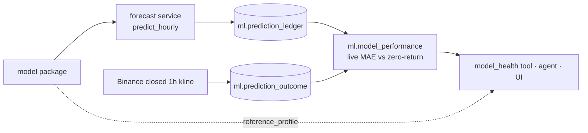

# Integrating a forecasting model

This page is for whoever builds the forecasting model. It says what the platform needs from a model,
what the platform does with it, and how a model goes from "trained" to "served".
The modelling itself (features, architecture, training) is up to you. The problem definition and the
time rules are fixed by [the hourly forecast contract](hourly_forecast_contract.md); read that first.

The CatBoost ensemble serving today (`agents/prediction.py`) is a placeholder so the rest of the system has
something to call. Its test Relative MAE is 0.997, i.e. barely better than predicting no change.

## 1. The prediction

| | |
|---|---|
| Target | `y = ln(close[t+1] / close[t])`: log-return of the next 1h Binance Spot candle |
| Assets | BTC first; ETH and SOL use the same contract |
| Input | Closed 1h candles up to `cutoff` (an exact UTC hour). At most 169 candles: `t-168 … t` |
| Output | One finite float, `predicted_log_return` |
| Baseline to beat | Zero return ("price does not move"). Relative MAE = model MAE / zero-return MAE |

Rules that hold for every model:

- Use only candles that closed at or before `cutoff`. Never read the target hour or anything after it.
- No network calls, no fitting and no randomness at inference. Same input, same output.
- CPU only, under 2 seconds per prediction, in a 1 GB container.
- A regression output is not a probability. Do not add `probability_up` or a confidence unless it is calibrated
  and evaluated separately.

## 2. What you hand over: a model package

```text
data/models/forecast/<model_id>/<version>/
├── manifest.json            identity, inputs, artifacts and their SHA-256, offline metrics
├── model files              any format your entrypoint loads (CatBoost .cbm, XGBoost .ubj, ONNX, …)
├── predict.py               the entrypoint below
└── reference_profile.json   feature distributions on the training period, for drift monitoring
```

`manifest.json`:

```json
{
  "model_id": "btc_hourly_xgb",
  "version": "2026-11-02-a",
  "symbols": ["BTC"],
  "input_assets": ["BTC", "ETH"],
  "lookback_hours": 169,
  "feature_version": "hourly-return-v2",
  "entrypoint": "predict:predict",
  "artifacts": {"model.ubj": "<sha256>", "predict.py": "<sha256>", "reference_profile.json": "<sha256>"},
  "training": {"period": "2020-01-01/2025-01-01", "git_commit": "<sha>", "data_snapshot_sha256": "<sha>"},
  "offline_metrics": {"validation_relative_mae": 0.97, "validation_n": 8760, "test_relative_mae": null}
}
```

The entrypoint:

```python
def predict(contexts: dict[str, CandleContext]) -> dict:
    """contexts maps each asset in input_assets to its CandleContext (agents/domain.py):
    169 closed 1h candles ending at the cutoff, validated (UTC, no gaps, OHLC sane)."""
    return {
        "predicted_log_return": 0.00042,      # required, finite
        "features": {"ret_1": 0.001, ...},    # optional: the feature row used, for drift and debugging
        "details": {...},                     # optional: anything else worth logging
    }
```

The serving layer adds everything else: timestamps, the reference close, `predicted_close_usdt`, input and
artifact hashes. You don't produce those, so they can't be inconsistent.

`reference_profile.json` describes each input feature on the training period: the inner bin edges (deciles,
so 9 edges for 10 bins) and the fraction of training rows in each bin. Monitoring compares the last 168 hours
against it with PSI (population stability index). It's the same format the anomaly model stores in its
`model.json` and reads in `warehouse_agents/anomaly.py:population_shift`:

```json
{"ret_1": {"inner_edges": [-0.0089, …, 0.0091], "bin_fractions": [0.1, …, 0.1]}, …}
```

## 3. What the platform does with it



1. **Served:** the forecast service loads the package, checks every artifact hash against the manifest, and
   answers `predict_hourly` (A2A/MCP, [contract](agent_contracts.md#2-contract-forecast-btc-giờ)).
2. **Recorded:** every hour, a few minutes after the close, `agents/ledger.py` asks the service for the
   current forecast and appends it to `ml.prediction_ledger`. It never updates or deletes a row.
3. **Scored:** once the target hour closes, the ledger fetches its real close from the same Binance source
   and writes `ml.prediction_outcome`. The view `ml.prediction_scored` gives each forecast's error and the
   zero-return baseline's error on the same hour.
4. **Monitored:** `ml.model_performance` gives n, MAE, baseline MAE, relative MAE and directional accuracy per
   model over 24 h, 7 d and 30 d. `model_health` combines that with feature drift from
   `reference_profile.json`. Forecasts published more than 5 minutes after the cutoff are kept but excluded.

This is the **prospective prediction ledger**: the only honest way to know how a model does on data it has
never seen. A backtest on 2026 can't do that any more, because 2026 has already been looked at.

### Recording forecasts yourself

A model can be shadow-tested before it is served: write its forecasts to the same ledger with
`agents.ledger.record(conn, ForecastRecord(...))`. `ForecastRecord` enforces the contract: UTC hour cutoff,
`generated_at` not before the cutoff, finite values, BTC/ETH/SOL only. Shadow and served models are scored on
exactly the same hours and outcomes, so they can be compared directly.

## 4. From trained to served

| Stage | Gate |
|---|---|
| Offline | Validation Relative MAE ≤ 0.95 (hourly contract §4). Test is retrospective only |
| Shadow | Writes to the ledger for at least 7 days (168 scored hours), not shown to users |
| Promote | Live relative MAE below the served model's on the same hours, and below 1.0 |
| Watch | `model_health` drift flags (PSI ≥ 0.25) and 7 d live relative MAE. A flag is a prompt to look, not an automatic retrain |

The shadow and promote thresholds are a proposal; agree on them before the first comparison, not after.

## 5. Status

| Part | State |
|---|---|
| Ledger tables, scoring views, hourly recorder | Done (`postgres/migrations/006_prediction_ledger.sql`, `agents/ledger.py`) |
| `ForecastRecord` contract and tests | Done (`tests/agents/test_ledger.py`) |
| Forecast service loading any package from a manifest | Not yet: it loads only the pinned CatBoost bundle. To be built when the first new package arrives |
| Drift per model from `reference_profile.json` | In progress (Phase D) |

## Checklist for a new model

- [ ] `predict(contexts)` uses only candles up to the cutoff, with a test that changing a future candle doesn't change the output
- [ ] `manifest.json` with every artifact's SHA-256
- [ ] `reference_profile.json` from the training period
- [ ] Offline report: validation Relative MAE against zero return, with n
- [ ] Runs on CPU in under 2 s, no network
