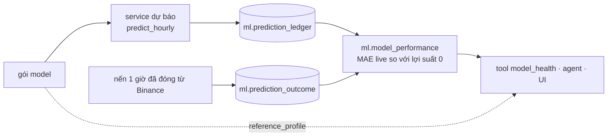

# Gắn một mô hình dự báo mới

> Trang này mô tả contract **legacy hourly** và prediction ledger cũ. Daily
> quantile model, forecast support và Paper Trade policy hiện tại được giải thích
> tại [Daily quantile trading policy](trading_policy_guide.md). Legacy
> `model_health`/PSI hiện production-disabled.

Trang này cho người xây mô hình dự báo: nền tảng cần gì từ một model, làm gì với nó, và model đi từ "đã train"
tới "đang phục vụ" thế nào. Cách làm model (feature, kiến trúc, huấn luyện) do bạn quyết định. Bài toán và quy tắc
thời gian cố định trong [Giao ước dự báo giờ](hourly_forecast_contract.md); đọc trang đó trước.

Ensemble CatBoost đang phục vụ (`agents/prediction.py`) chỉ là model giữ chỗ để phần còn lại của hệ thống có thứ
để gọi. Relative MAE trên test là 0,997, tức gần như không hơn việc đoán "giá không đổi".

## Dự báo

| | |
|---|---|
| Target | `y = ln(close[t+1] / close[t])`: log return của nến 1 giờ Binance Spot kế tiếp |
| Asset | BTC trước; ETH và SOL dùng cùng giao ước |
| Đầu vào | Nến 1 giờ đã đóng tới `cutoff` (một giờ UTC chẵn). Tối đa 169 nến: `t-168 … t` |
| Đầu ra | Một số thực hữu hạn, `predicted_log_return` |
| Baseline cần thắng | Lợi suất 0 ("giá không đổi"). Relative MAE = MAE model / MAE baseline |

Quy tắc cho mọi model:

- Chỉ dùng nến đã đóng trước hoặc tại `cutoff`. Không đọc giờ target hay bất cứ gì sau đó.
- Khi dự báo: không gọi mạng, không fit, không ngẫu nhiên. Cùng đầu vào, cùng đầu ra.
- Chỉ CPU, dưới 2 giây mỗi lần, trong container 1 GB.
- Đầu ra hồi quy không phải xác suất. Không thêm `probability_up` hay độ tin cậy nếu chưa hiệu chỉnh và đánh giá riêng.

## Bàn giao: một gói model

```text
data/models/forecast/<model_id>/<version>/
├── manifest.json            định danh, đầu vào, artifact và SHA-256, metric offline
├── file model               định dạng bất kỳ mà entrypoint đọc được (CatBoost .cbm, XGBoost .ubj, ONNX…)
├── predict.py               entrypoint bên dưới
└── reference_profile.json   phân phối feature trên giai đoạn train, để theo dõi drift
```

`manifest.json`:

```json
{
  "model_id": "btc_hourly_xgb",
  "version": "2026-11-02-a",
  "symbols": ["BTC"],
  "input_assets": ["BTC", "ETH"],
  "lookback_hours": 169,
  "feature_version": "hourly-return-v2",
  "entrypoint": "predict:predict",
  "artifacts": {"model.ubj": "<sha256>", "predict.py": "<sha256>", "reference_profile.json": "<sha256>"},
  "training": {"period": "2020-01-01/2025-01-01", "git_commit": "<sha>", "data_snapshot_sha256": "<sha>"},
  "offline_metrics": {"validation_relative_mae": 0.97, "validation_n": 8760, "test_relative_mae": null}
}
```

Entrypoint:

```python
def predict(contexts: dict[str, CandleContext]) -> dict:
    """contexts: mỗi asset trong input_assets → CandleContext (agents/domain.py):
    169 nến 1 giờ đã đóng tới cutoff, đã kiểm tra (UTC, không thiếu giờ, OHLC hợp lệ)."""
    return {
        "predicted_log_return": 0.00042,      # bắt buộc, hữu hạn
        "features": {"ret_1": 0.001, ...},    # tùy chọn: dòng feature đã dùng, cho drift và debug
        "details": {...},                     # tùy chọn: thông tin khác đáng ghi
    }
```

Tầng phục vụ thêm phần còn lại: mốc thời gian, giá đóng tham chiếu, `predicted_close_usdt`, hash đầu vào và artifact.
Bạn không tạo các trường này nên chúng không thể lệch nhau.

`reference_profile.json` mô tả mỗi feature trên giai đoạn train: các mốc chia bin bên trong (decile, nên 9 mốc
cho 10 bin) và tỉ lệ dòng train trong mỗi bin. Theo dõi so 168 giờ gần nhất với nó bằng PSI. Cùng định dạng mà
model anomaly lưu trong `model.json` và đọc ở `warehouse_agents/anomaly.py:population_shift`:

```json
{"ret_1": {"inner_edges": [-0.0089, …, 0.0091], "bin_fractions": [0.1, …, 0.1]}, …}
```

## Nền tảng legacy hourly làm gì với model



> Luồng này được giữ tạm để rollback/ledger hourly. Public support hiện dùng
> `forecast_support`; xem [implementation report](forecast_support_implementation_report.md).

1. **Phục vụ legacy:** service dự báo nạp gói, kiểm mọi hash artifact theo manifest, trả lời `predict_hourly`
   (A2A/MCP, [giao ước](agent_contracts.md#2-contract-forecast-btc-giờ)).
2. **Ghi lại:** mỗi giờ, vài phút sau khi đóng nến, `agents/ledger.py` lấy dự báo hiện tại và thêm vào
   `ml.prediction_ledger`. Không bao giờ sửa hay xóa dòng.
3. **Chấm:** khi giờ target đóng, ledger lấy giá đóng thật từ cùng nguồn Binance và ghi `ml.prediction_outcome`.
   View `ml.prediction_scored` cho sai số của từng dự báo và của baseline lợi suất 0 trên cùng giờ.
4. **Theo dõi:** `ml.model_performance` cho n, MAE, MAE baseline, Relative MAE và độ chính xác hướng theo từng
   model trong 24 giờ, 7 và 30 ngày. `model_health` gộp số này với drift feature từ `reference_profile.json`. Dự báo
   công bố trễ hơn 5 phút sau cutoff vẫn được giữ nhưng không tính.

Đây là **prediction ledger dạng tiến**: cách trung thực duy nhất để biết model làm thế nào trên dữ liệu chưa từng
thấy. Backtest trên 2026 không làm được nữa, vì 2026 đã được xem.

### Tự ghi dự báo (shadow)

Một model có thể chạy thử trước khi phục vụ: ghi dự báo vào cùng ledger bằng
`agents.ledger.record(conn, ForecastRecord(...))`. `ForecastRecord` ép giao ước: cutoff là giờ UTC chẵn,
`generated_at` không trước cutoff, giá trị hữu hạn, chỉ BTC/ETH/SOL. Model shadow và model đang phục vụ được chấm
trên đúng cùng giờ và cùng kết quả, nên so sánh trực tiếp được.

## Từ train tới phục vụ

| Giai đoạn | Điều kiện qua |
|---|---|
| Offline | Relative MAE trên validation ≤ 0,95 (giao ước giờ §4). Test chỉ để nhìn lại |
| Shadow | Ghi vào ledger ít nhất 7 ngày (168 giờ đã chấm), không hiện cho người dùng |
| Lên phục vụ | Relative MAE live thấp hơn model đang phục vụ trên cùng giờ, và dưới 1,0 |
| Theo dõi | Cờ drift của `model_health` (PSI ≥ 0,25) và Relative MAE live 7 ngày. Cờ là để xem lại, không tự retrain |

Ngưỡng shadow và lên phục vụ là đề xuất; thống nhất trước lần so sánh đầu tiên, không phải sau.

## Trạng thái

| Phần | Trạng thái |
|---|---|
| Bảng ledger, view chấm, bộ ghi mỗi giờ | Xong (`postgres/migrations/006_prediction_ledger.sql`, `agents/ledger.py`) |
| Giao ước `ForecastRecord` và test | Xong (`tests/agents/test_ledger.py`) |
| Service dự báo nạp gói bất kỳ từ manifest | Chưa: hiện chỉ nạp bundle CatBoost cố định. Làm khi có gói mới đầu tiên |
| Drift theo từng model từ `reference_profile.json` | Xong cho model dự báo hiện tại (cửa sổ 30 ngày) |

## Checklist cho một model mới

- [ ] `predict(contexts)` chỉ dùng nến tới cutoff, có test đổi nến tương lai không đổi đầu ra
- [ ] `manifest.json` có SHA-256 của mọi artifact
- [ ] `reference_profile.json` từ giai đoạn train
- [ ] Báo cáo offline: Relative MAE trên validation so với lợi suất 0, kèm n
- [ ] Chạy trên CPU dưới 2 giây, không gọi mạng
