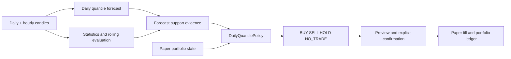

# Daily quantile trading policy: hướng dẫn từ đầu đến cuối

Tài liệu này giải thích implementation Paper Trade hiện tại cho người chưa quen
với forecasting, portfolio hoặc policy giao dịch. Đây là hệ thống **nghiên cứu và
giả lập**, không kết nối sàn và không được xem là lời khuyên đầu tư.

## 1. Ba lớp khác nhau trong hệ thống

Điều quan trọng nhất là không gọi tất cả mọi thứ là “trading model”. Hệ thống có
ba lớp độc lập:

1. **Forecast model** đọc dữ liệu lịch sử và dự báo ba quantile return của giá
   đóng cửa UTC ngày tiếp theo: q10, q50 và q90.
2. **Support system** bổ sung performance gần đây, thống kê daily, trend hourly,
   data readiness, freshness và lineage. Các con số này được tính bằng code xác
   định, không phải do LLM tự suy luận.
3. **Trading policy** nhận toàn bộ support evidence cùng trạng thái portfolio,
   tạo một `signed_score`, chuyển nó thành target allocation rồi mới quyết định
   `BUY`, `SELL`, `HOLD` hoặc `NO_TRADE`.

Trade Agent chỉ giải thích evidence/policy. Agent không được tự tạo hoặc xác nhận
lệnh. Người dùng phải preview và confirm paper order trong dashboard.



## 2. Forecast model dự báo cái gì?

Target là log return từ giá đóng cửa tham chiếu sang giá đóng cửa ngày kế tiếp:

```text
r = log(next_close / reference_close)
next_close = reference_close × exp(r)
```

Model trả ba giá trị:

| Output | Cách đọc |
| --- | --- |
| `return_q10` | Biên thấp mà model đã học; mô tả phía bất lợi của phân phối dự báo |
| `return_q50` | Median dự báo; dùng làm dự báo trung tâm và hướng tăng/giảm |
| `return_q90` | Biên cao mà model đã học; mô tả phía thuận lợi của phân phối dự báo |

Giá dự báo tương ứng là:

```text
close_q10 = reference_close × exp(return_q10)
close_q50 = reference_close × exp(return_q50)
close_q90 = reference_close × exp(return_q90)
```

q10–q90 là **empirical model interval**, không phải cam kết rằng giá thật chắc
chắn nằm trong khoảng đó và cũng không nên gọi cứng là “80% confidence”. Coverage
thực tế được đo lại trong `recent_performance`.

Ví dụ cách đọc:

- q10, q50, q90 đều dương: toàn bộ khoảng dự báo nằm phía tăng.
- cả ba đều âm: toàn bộ khoảng dự báo nằm phía giảm.
- q10 âm nhưng q90 dương: khoảng dự báo cắt qua zero; hướng chưa chắc chắn.
- q50 chỉ hơi dương nhưng q10 rất âm: median tăng nhẹ không xóa tail risk giảm.

Policy hiện tại dùng dấu của q50 cho hướng trung tâm. Nó **không** cộng q10 + q50
+ q90 để quyết định hướng.

## 3. Forecast support gồm những gì?

`ForecastSupportService` chỉ trả `status=ready` sau khi kiểm tra đúng model bundle,
đúng feature layout và đủ daily/hourly grid. Nếu thiếu, service chỉ backfill đúng
khoảng nội bộ đã tính; nó không tải lại toàn bộ lịch sử.

### 3.1 Recent performance

Đây là rolling backtest causal trên `N` target day gần nhất đã có ground truth,
dùng cùng frozen serving bundle:

| Field | Ý nghĩa |
| --- | --- |
| `sample_count` | Số ngày thật sự được chấm |
| `directional_accuracy` | Tỷ lệ dấu q50 giống dấu actual return |
| `balanced_accuracy` | Trung bình recall của lớp tăng và lớp giảm; hữu ích khi hai lớp lệch tỷ lệ |
| `mcc` | Matthews correlation coefficient; gần 0 nghĩa là ít quan hệ, +1 hoàn hảo, -1 ngược hoàn toàn |
| `mae_return` | Trung bình `abs(q50 - actual_return)` |
| `rmse_return` | Căn trung bình bình phương lỗi; nhạy hơn với lỗi lớn |
| `mae_price_usdt` | Sai số tuyệt đối trung bình sau khi đổi return về giá |
| `zero_return_mae` | MAE của baseline dự báo return bằng 0, tức next close bằng current close |
| `relative_mae` | `model_mae / zero_return_mae`; nhỏ hơn 1 mới thắng baseline no-change |
| `actual_up_rate` | Tỷ lệ ngày thật sự tăng |
| `predicted_up_rate` | Tỷ lệ ngày q50 dự báo tăng |
| `q10_q90_empirical_coverage` | Tỷ lệ actual return nằm trong q10–q90 |
| `mean_interval_width` | Độ rộng trung bình q90−q10; rộng hơn thường là uncertainty lớn hơn |
| `pinball_loss_q10/q50/q90` | Loss chuyên biệt để đánh giá từng quantile |

Đây là retrospective diagnostic, chưa phải prospective guarantee. Policy trực
tiếp dùng `sample_count`, `directional_accuracy` và `relative_mae`; các metric còn
lại được trả về để con người/agent đánh giá.

### 3.2 Daily market statistics

Với close `C_t`, daily log return là:

```text
r_t = log(C_t / C_(t-1))
```

| Field | Cách tính và cách đọc | Policy dùng? |
| --- | --- | --- |
| `cumulative_return` | `exp(sum(r_t)) - 1`; tổng mức tăng/giảm của window | Có, trong momentum |
| `cumulative_log_return` | `sum(r_t)` | Chỉ quan sát |
| `mean_daily_return` | Trung bình daily log return | Chỉ quan sát |
| `median_daily_return` | Median daily log return, ít nhạy outlier hơn mean | Chỉ quan sát |
| `realized_volatility` | Độ lệch chuẩn daily return trong window | Có, chuẩn hóa momentum |
| `annualized_volatility` | `realized_volatility × sqrt(365)` | Có, risk penalty |
| `maximum_drawdown` | Mức giảm tệ nhất từ running peak xuống close sau đó | Có, risk penalty |
| `highest_close_usdt` | Close cao nhất trong window | Chỉ quan sát |
| `lowest_close_usdt` | Close thấp nhất trong window | Chỉ quan sát |
| `average_quote_volume` | Trung bình volume USDT | Chỉ quan sát |
| `mean_log_volume_change` | Trung bình thay đổi `log(1 + volume)` | Chỉ quan sát |
| `average_high_low_range` | Trung bình `log(high/low)` | Chỉ quan sát |
| `up_days` | Số daily return dương | Gián tiếp |
| `down_or_flat_days` | Số daily return không dương | Gián tiếp |
| `up_day_ratio` | `up_days / sample_count` | Có, trong up-day balance |

Volatility không nói hướng. Một thị trường có thể volatility cao trong cả đợt
tăng mạnh lẫn giảm mạnh. Drawdown luôn bằng 0 hoặc âm; ví dụ `-0.20` nghĩa là từng
giảm 20% so với peak trước đó trong window.

### 3.3 Closed-hour trend

Trend hourly dùng `K` nến giờ đã đóng, fit đường thẳng lên log close:

```text
log(close_t) ≈ intercept + slope × t
```

| Field | Ý nghĩa |
| --- | --- |
| `direction` | `up` nếu slope dương, `down` nếu slope âm |
| `slope_per_hour` | Tốc độ thay đổi log-price theo giờ |
| `regression_r_squared` | 0–1; mức độ đường thẳng giải thích được chuyển động. Thấp nghĩa là trend nhiễu/yếu |
| `cumulative_return` | Return toàn window hourly |
| `up_candle_ratio` | Tỷ lệ hourly return dương |
| `realized_volatility` | Độ lệch chuẩn hourly return |
| `maximum_drawdown` | Drawdown trong hourly window |
| `close_vs_ema_24h` | Close hiện tại lệch EMA 24h bao nhiêu |
| `close_vs_ema_168h` | Close hiện tại lệch EMA 168h bao nhiêu; null nếu window chưa đủ |

Policy chỉ dùng `direction` và `regression_r_squared`. Những field còn lại giúp
dashboard/agent mô tả bối cảnh nhưng không tự động làm thay đổi score.

### 3.4 Readiness, freshness và lineage

- `data_readiness`: grid cần cho model đã đủ timestamp/symbol chưa.
- `data_freshness`: daily/hourly candle cuối có đúng cutoff đã đóng không.
- `lineage`: batch IDs đã tạo evidence.
- `model`: run ID, snapshot, feature version, asset order và checksums.

Đây là các bằng chứng audit. Thiếu grid hoặc artifact sai checksum thì policy
không được phép “đoán tạm”.

## 4. Portfolio là gì?

Portfolio là ví giấy tách biệt theo user:

| Khái niệm | Ý nghĩa |
| --- | --- |
| `cash_usdt` | Tiền mặt chưa đầu tư |
| `position_quantity` | Số lượng coin đang nắm |
| `current_price_usdt` | Giá nến 1 phút đã đóng mới nhất dùng để mark position |
| `position_value_usdt` | `quantity × current_price` |
| `equity_usdt` | `cash + tổng position value` |
| `position_fraction` | `position_value / equity`; tỷ trọng tài sản hiện tại |
| `average_entry_price_usdt` | Giá vốn bình quân có trọng số của position đang mở |
| `realized_pnl_usdt` | Lãi/lỗ đã chốt qua SELL; position chưa bán không nằm ở đây |
| `unrealized_pnl_usdt` | Lãi/lỗ tạm tính của position còn mở |
| `maximum_drawdown` | Drawdown hiện tại so với equity peak đã ghi nhận |

Policy là `long_only_spot`: không short, không leverage, không âm cash và không
bán nhiều hơn quantity đang có.

## 5. Các gate trước khi chấm điểm

Policy trả `NO_TRADE` ngay nếu một trong các điều kiện sau xảy ra:

1. forecast support không `ready`;
2. input grid chưa complete;
3. q10 ≤ q50 ≤ q90 không đúng;
4. target daily candle đã đóng hoặc hết hạn;
5. execution price nằm trong tương lai bất thường hoặc cũ hơn
   `max_price_age_seconds`;
6. rolling evaluation có ít hơn `min_performance_samples`.

`NO_TRADE` khác `HOLD`:

- `NO_TRADE`: không đủ điều kiện để policy đưa ra quyết định hợp lệ.
- `HOLD`: evidence hợp lệ, policy đã đánh giá nhưng không cần thay đổi allocation.

## 6. Sáu component tạo signed score

Tất cả component được ép về khoảng gần `[-1, 1]`. Dương là bullish, âm là
bearish. `signed_score` là heuristic support score, **không phải xác suất**.

### 6.1 Median direction — trọng số 30%

```text
interval_width = max(q90 - q10, 0.000001)
scale = max(interval_width / 2, 0.005)
median_direction = tanh(q50 / scale)
```

q50 càng xa zero so với độ rộng interval thì tín hiệu càng mạnh. Floor `0.005`
ngăn interval quá hẹp làm một q50 rất nhỏ bị khuếch đại thành score gần ±1.

### 6.2 Interval position — trọng số 25%

```text
if q10 > 0: interval_position = +1
elif q90 < 0: interval_position = -1
else: interval_position = clip(q50 / interval_width, -1, +1)
```

Nếu toàn interval cùng một phía zero, component đạt cực trị. Nếu interval cắt
zero, q50 được giảm theo độ rộng interval và thêm risk flag
`forecast_interval_crosses_zero`.

### 6.3 Direction reliability — trọng số 20%

```text
sample_weight = min(1, sample_count / 30)
reliability = clip((directional_accuracy - 0.5) / 0.10, 0, 1)
              × sample_weight
direction_reliability = sign(q50) × reliability
```

- Accuracy 50% hoặc thấp hơn cho reliability bằng 0.
- Accuracy 60% đạt phần accuracy tối đa.
- Ít hơn 30 mẫu thì bị giảm tuyến tính.
- Dấu của component theo q50: performance chỉ điều chỉnh độ tin cậy, không tự
  tạo hướng mới.

Đây là mapping heuristic, không phải calibration xác suất.

### 6.4 Trend alignment — trọng số 15%

```text
trend_alignment = sign(hourly_regression_slope) × regression_r_squared
```

Trend tăng nhưng R² thấp chỉ hỗ trợ nhẹ; trend giảm rõ với R² cao kéo score âm.

### 6.5 Momentum — trọng số 7%

```text
denominator = max(daily_volatility × sqrt(sample_count), 0.02)
momentum = tanh(cumulative_return / denominator)
```

Momentum so return tích lũy với volatility của cùng window. Floor `0.02` tránh
thị trường quá yên làm một thay đổi nhỏ bị phóng đại.

### 6.6 Up-day balance — trọng số 3%

```text
up_day_balance = clip((up_day_ratio - 0.5) × 2, -1, +1)
```

50% ngày tăng cho 0; toàn ngày tăng cho +1; không có ngày tăng cho -1.

### 6.7 Công thức tổng

```text
signed_score = clip(
    0.30 × median_direction
  + 0.25 × interval_position
  + 0.20 × direction_reliability
  + 0.15 × trend_alignment
  + 0.07 × momentum
  + 0.03 × up_day_balance,
  -1, +1
)

support_score = abs(signed_score)
```

`support_score` chỉ đo độ mạnh, bỏ hướng. Muốn biết bullish/bearish phải đọc
`signed_score`.

## 7. Risk penalty sau khi có score

Các penalty nhân tuần tự lên signed score:

| Điều kiện | Hệ số | Flag |
| --- | ---: | --- |
| `relative_mae >= 1` | × 0.9 | `mae_does_not_beat_zero_return` |
| Annualized volatility vượt config | × 0.7 | `high_market_volatility` |
| Market drawdown sâu hơn config | × 0.7 | `deep_market_drawdown` |

Penalty giảm độ mạnh nhưng không đảo dấu. Nếu cùng lúc có nhiều flag, các hệ số
được nhân liên tiếp. Portfolio drawdown là hard risk rule riêng: khi chạm giới
hạn, target allocation bị đưa về 0 để thoát position.

## 8. Từ score sang target allocation và action

### 8.1 Target allocation

```text
if portfolio drawdown vượt giới hạn:
    target_fraction = 0
elif signed_score >= trade_threshold:
    target_fraction = min(
        max_asset_fraction,
        max_asset_fraction × abs(signed_score)
    )
elif signed_score <= -trade_threshold:
    target_fraction = 0
else:
    target_fraction = current_position_fraction
```

Trong long-only policy, bearish không mở short; nó chỉ yêu cầu giảm position về
0. Nếu đang không giữ coin, kết quả hợp lý là HOLD với
`no_position_to_sell`.

### 8.2 Rebalance delta

```text
delta_fraction = target_fraction - current_position_fraction
```

- `abs(delta) <= rebalance_tolerance` → HOLD.
- `delta > 0` → BUY.
- `delta < 0` → SELL.

Notional BUY bị giới hạn bởi ba thứ:

```text
min(delta × equity, max_order_fraction × equity, cash)
```

Notional SELL bị giới hạn bởi:

```text
min(-delta × equity, max_order_fraction × equity, position_value)
```

Vì vậy target có thể cần nhiều lần rebalance mới đạt được; một lần đánh giá không
được phép đổi position quá lớn.

## 9. Ý nghĩa từng config

File mặc định: `pipeline/decision/trading/policies/daily_quantile_v1.json`.

| Field | Ý nghĩa | Giảm giá trị sẽ… | Tăng giá trị sẽ… |
| --- | --- | --- | --- |
| `min_performance_samples` | Mẫu rolling tối thiểu | cho policy hoạt động sớm hơn nhưng ít bằng chứng | cần nhiều lịch sử hơn |
| `trade_threshold` | Độ lớn signed score để đổi allocation | giao dịch thường xuyên hơn | chọn lọc tín hiệu mạnh hơn |
| `max_asset_fraction` | Tỷ trọng equity tối đa cho một coin | giảm exposure | tăng exposure/risk |
| `max_order_fraction` | Tỷ lệ equity tối đa mỗi order | rebalance chậm, giảm thiệt hại mỗi lần sai | vào/thoát nhanh hơn |
| `max_annualized_volatility` | Mốc kích hoạt volatility penalty | penalty xuất hiện thường hơn | chịu volatility cao hơn trước khi phạt |
| `max_market_drawdown_fraction` | Độ sâu market drawdown kích hoạt penalty | thận trọng hơn | ít penalty hơn |
| `max_portfolio_drawdown_fraction` | Drawdown portfolio buộc target về 0 | risk exit sớm hơn | chịu lỗ sâu hơn |
| `rebalance_tolerance` | Delta allocation nhỏ nhất đáng giao dịch | nhiều order nhỏ hơn | nhiều HOLD hơn |
| `slippage_bps` | Trượt giá giả lập; 1 bps = 0.01% | fill gần market hơn | giả lập fill bất lợi hơn |
| `max_price_age_seconds` | Tuổi tối đa của closed-minute execution price | dễ block vì stale | chấp nhận giá cũ hơn |

`policy_id`, `mode` và `deployment_tier` không cho browser thay đổi. Khi user save
config, server chuẩn hóa field, tạo version `v1-user-<digest>` và SHA-256. Mỗi
decision lưu nguyên policy config để thay đổi sau này không làm biến nghĩa quyết
định cũ.

## 10. Preview, confirm và paper fill

Policy chỉ tạo draft. Một order chỉ được ghi khi:

1. decision có `executable=true` và action là BUY/SELL;
2. decision chưa hết hạn;
3. closed-minute execution price đủ mới;
4. user preview order;
5. user confirm đúng `source_candle_time` đã preview;
6. cash/position vẫn thỏa long-only constraint.

BUY fill price = market price cộng slippage; SELL fill price = market price trừ
slippage. Hệ thống hiện **không mô phỏng exchange fee**. `idempotency_key`, row
lock và immutable fills ngăn double-click hoặc concurrent confirmation tạo lệnh
trùng.

## 11. Backtest được chạy như thế nào?

Backtest tạo một support payload causal cho từng cutoff UTC:

- chỉ dùng candle có sẵn trước cutoff để tạo feature/statistic;
- actual target close chỉ được gắn sau đó để chấm kết quả;
- replay cash, quantity, average entry và slippage theo thứ tự thời gian;
- không ép thanh lý position cuối kỳ; final equity mark-to-market.

Các metric chính:

| Metric | Ý nghĩa |
| --- | --- |
| `total_return` | `(final_equity / initial_cash) - 1` |
| `profit_loss_usdt` | `final_equity - initial_cash` |
| `maximum_drawdown` | Drawdown equity tệ nhất |
| `buy_hold_return` | Mua coin bằng toàn bộ initial cash ở đầu và giữ tới cuối |
| `excess_return_vs_buy_hold` | Policy return trừ buy-and-hold return |
| `turnover_usdt` | Tổng notional đã giao dịch |
| `action_counts` | Số BUY/SELL/HOLD/NO_TRADE |
| `forecast_direction_diagnostics` | Ma trận dấu q50 so với realized next-day return |

`Policy equity` là cash cộng market value của position. Nó thường vẫn cùng hướng
thị trường khi policy đang giữ coin, nhưng biên độ nhỏ hơn nếu allocation dưới
100%. `Buy & hold equity` gần như là đường giá thị trường được scale theo initial
cash vì benchmark luôn giữ 100% coin.

### Action utility không phải portfolio P&L

- BUY useful nếu target close sau đó cao hơn fill BUY.
- SELL useful nếu bán giúp tránh được phần giảm tới target close.
- HOLD useful tùy context: đang giữ coin thì ngày tăng có ích; đang cash thì ngày
  giảm có ích.

Một policy có tỷ lệ action useful cao vẫn có thể lỗ nếu những lần sai có magnitude
lớn hơn, allocation lớn hơn, hoặc timing BUY/SELL làm bỏ lỡ đợt tăng dài. Vì vậy
phải đọc đồng thời return, drawdown, buy-and-hold, effect USDT và sample count.

## 12. Flow code để đọc implementation

Đọc theo thứ tự sau:

1. `pipeline/decision/serving/support_service.py`: orchestration support payload.
2. `pipeline/decision/serving/daily_forecast_service.py`: q10/q50/q90 inference.
3. `pipeline/decision/serving/rolling_evaluation.py`: recent performance.
4. `pipeline/decision/serving/market_statistics.py`: daily/hourly statistics.
5. `pipeline/decision/trading/contracts.py`: portfolio/decision/order contracts.
6. `pipeline/decision/trading/policy.py`: score, penalty, allocation và action.
7. `pipeline/decision/trading/decision_service.py`: freeze evidence và policy.
8. `pipeline/decision/trading/repository.py`: persistence, preview và atomic fill.
9. `pipeline/decision/trading/historical_backtest.py`: tạo observation causal.
10. `pipeline/decision/trading/backtest.py`: replay và report metrics.
11. `app/paper_trading.py`: authenticated REST endpoints.
12. `frontend/src/trading/TradingDashboard.jsx`: live paper workspace.
13. `frontend/src/trading/PolicyWorkbench.jsx`: config và backtest UI.

## 13. Những điều implementation chưa khẳng định

- Signed score không phải confidence probability.
- q10–q90 không phải guaranteed range.
- Rolling performance không đảm bảo regime ngày mai giống window vừa qua.
- Backtest tốt không chứng minh hiệu quả live.
- Chưa mô phỏng exchange fee, latency, partial fill hoặc market impact.
- Paper fill không gửi lệnh ra Binance hay bất kỳ exchange nào.
- Policy heuristic chưa được phê duyệt cho tiền thật.
- Legacy `/drift` và `model_health` đang production-disabled vì phụ thuộc artifact
  anomaly/hourly cũ, không đại diện model daily quantile hiện tại.

Các artifact quyết định, evidence hash, model version, policy version và execution
price timestamp được giữ để có thể audit một kết quả cụ thể thay vì chỉ nhìn câu
giải thích của agent.
